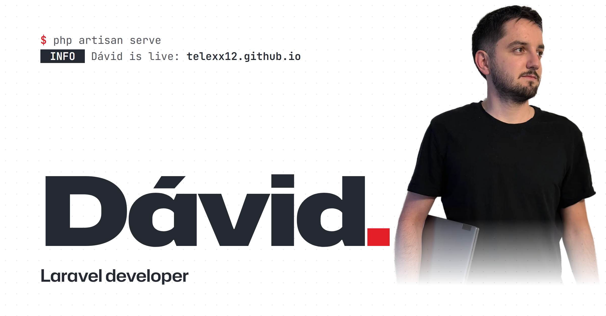

<p align="center">
  <a href="https://telexx12.github.io/"></a>
</p>

# telexx12.github.io

```text
$ laravel new david-portfolio
  - Installing problem solving (9.0)
  - Installing curiosity (5.0)
  …
 15/15 [▓▓▓▓▓▓▓▓▓▓▓▓▓▓▓▓▓▓▓▓] 100%
 DONE  Dávid installed successfully.

$ php artisan serve
 INFO  Dávid is live: http://Earth:8000
```

**Live:** https://telexx12.github.io/ · English and Hungarian

This is my personal site. I built it to be the home base of my work as a Laravel developer: the one place where people can find me, see what I have built, read what I write and get in touch. Everything else I publish will point back here.

It is a single page that does not open like a portfolio. It boots like a Laravel application, walks you through the request lifecycle as the story of how I got here, and lands on a `200 OK`. Below the landing come the normal sections: about, projects, blog and contact.

The whole thing is plain HTML, CSS and JavaScript with GSAP for the animations. No framework, no build step, hosted on GitHub Pages. This README is a making-of: for each part of the site, the idea, how it is built and what happens step by step. The last section is about how I built it together with an AI agent.

## Intro animation

**Concept.** A Laravel app does not just appear, it boots. So does the site. The first screen is a terminal that runs `laravel new david-portfolio`, installs fifteen traits as if they were Composer packages, asks the installer's questions (where to install: Romania; release date: 2001), prints `Dávid installed successfully` and starts the server with `php artisan serve`. The server address is `http://Earth:8000`. The only way to continue is one of two buttons: **Journey** sends a request and walks through the lifecycle, **Jump** goes straight to the response.

**How it works.** The terminal is real DOM: every line is a `.term-line` element in [components/home.html](components/home.html), and [home.js](assets/js/components/home.js) builds one time-based GSAP timeline over them. A line is "printed" by switching it to `display: block` at the right moment, and the block cursor is an attribute that moves from line to line. The commands are typed with a CSS custom property: the timeline tweens `--chars` from 0 to the length of the text with a `steps(n)` ease, and the stylesheet clips the text to that many characters. No per-character DOM.

The timing is relative, not hand-set. Each block starts at `tl.duration() + gap`, and there are only three gaps: `ROW` 0.04 s between list rows, `BEAT` 0.08 s before typing or after a command, and `PAUSE` 0.15 s between blocks. The whole boot is about 3.65 seconds and 33 lines. Any key press or tap skips it.

The terminal is a fixed, full-screen box with `flex-direction: column-reverse`, so it starts at the bottom like a real terminal, follows new lines as they print, and lets you scroll up through the log. The buttons work by press only, with the native Enter and Space on a focused button, and nothing else: I removed every custom shortcut.

**Steps.** `laravel new` and the red ASCII banner → the fifteen traits with a progress bar → two installer questions → `DONE` → `php artisan serve` → `INFO Dávid is live` → the two buttons pop in.

The terminal is one-way. Once you leave it there is no way back except a reload, and every reload starts here: [preferences.js](assets/js/preferences.js) strips any URL hash and turns off scroll restoration. The one exception is the browser's Back button from a blog post, which restores the page where you left it.

## The journey

**Concept.** The path from the terminal to the landing is a Laravel request lifecycle, told as my own story. The stations are the stages a request passes through:

| Station | Laravel stage | What it shows |
|---|---|---|
| Studies | service providers loading | high school, university, Laracasts |
| Work | routing, `GET /leading-soft` … | my workplaces as route signs |
| Filters | middleware | three "filters" my life passed through, with a log line each |
| Landing | the response, `200 OK` | me today |

A red thread runs through all of it, and each station places one row of a three-row jigsaw of my portrait. The picture is complete when the response arrives.

**How it works.** Pressing **Journey** fires a `story:request` event (a ripple on the background), then a browser window grows out of the button: [studies.js](assets/js/components/studies.js) scales a window frame from the button's position to the full screen, runs a loading bar in its chrome and slides the chrome away. From there the page scrolls by itself. [boot-story.js](assets/js/components/boot-story.js) builds a GSAP timeline that tweens `document.scrollingElement.scrollTop` one leg per station (1.2 s each, `sine.inOut`, so it slows down where the station plays) and ends on the landing. Any wheel, touch, click or key during the journey hurries it to the end. From the button to the finished landing it is about 7.7 seconds. **Jump** does the same instantly.

The red thread is one engine, [thread.js](assets/js/components/thread.js). It never has a hard-coded path. Each station marks its elements with data attributes (`data-thread-start`, `-axis`, `-shelf`, `-stop`, `-follow`, `-board`, `-end`), and the engine measures their boxes, plans a route with rounded corners, writes it as one SVG path per station, and moves a dot along it with CSS `offset-path`. Eyelets appear where the thread enters and leaves an element. The stations only set `--thread-*` custom properties as hints (the inset, the direction, how to approach the board); all the geometry lives in the engine.

The thread is scroll-driven. Each station has a ScrollTrigger-scrubbed timeline, and the engine times the dot so that an element animates while it crosses a reading line at 80% of the viewport height. Cards only start once they are fully on screen. The Studies station is special: its intro plays on its own timeline right after the browser opens (`Thread.claim(section)`), and the journey waits for it. The jigsaw geometry (knobs, seams, the three rows) is also in thread.js: the board is an SVG with clip paths, the bands of the new piece fill one after another, then the piece snaps into place with a `back.out` ease.

Each station has its own character. Studies are notebook pages whose ruled lines write themselves in as the dot passes. Work is a row of street signs with `GET /slug` headers. Filters is a middleware log that types each line (`→ HandleExamSession .... ✓ got away with it`) as the dot passes the filter. A thin red progress line under the top bar follows the whole journey and fades out on the landing.

Behind everything is a dot grid on a canvas, [background.js](assets/js/components/background.js). The dots are a CSS background; the canvas only paints the lit ones. A light follows the pointer through `gsap.quickTo`, and every story event (`story:request`, `thread:pass`, `story:navigate`, `story:phase`, `story:loaded`) sends a ripple from the element that caused it. The canvas redraws only when something changed, inside `gsap.ticker`.

**Steps.** Request → the browser window opens → Studies intro (thread, three pages, first puzzle row) → scroll to Work (signs light up, second row) → scroll to Filters (log lines type, third row) → the thread drops into the landing's loader.

## Landing page

**Concept.** The response. The thread ends in a loader ring around my face, the ring fills, the face sharpens, `200 OK`, and the page I am "serving" assembles itself: my photo, my name, the four menu items and the contact icons. It is designed for a phone first: the name, the photo and a dock at the bottom, with smoke rising behind me so that something moves even when you do nothing.

**How it works.** [landing.js](assets/js/components/landing.js) owns one paused GSAP timeline, the boot. It starts when the thread lands (`thread:landed`) or when the journey arrives. The ring is a single SVG circle whose dash length is `--fill`, rotated so it fills from 12 o'clock, exactly where the thread arrives; the ring's stroke is derived from the thread's width token, so the line continues into the ring without a seam. While the ring fills, the face inside goes from blurred and grey to sharp in three steps.

Then the finale: `200 OK` appears, the loader blows up and fades, the photo scales in, the smoke rises (a `--rise` property drives the translate and the opacity of the smoke layers), the five letters of the name pop in one by one, the dock's glass frame draws itself and the contact icons pop. The four dock links fly out of the ring into their slots on a curved path: x with `power2.out`, y with `power3.in`, a squash on landing and a ripple on the background.

The smoke is CSS only: two screen-sized layers of stacked radial gradients that drift and rotate, plus seven puffs that rise from the shoulders to above the head. Smooth gradients have no features the eye can track, so the puffs are masked with a procedural smoke texture (`assets/img/smoke.webp`, generated with fractal noise). It is red in the light theme and white in the dark one. Under `prefers-reduced-motion` the puffs are hidden and the cloud is static.

The big outlined name is set in Hubot Sans Expanded Black. The first version used the system font with `-webkit-text-stroke`, which looked fine on Windows and broke on my Android phone: variable system fonts have overlapping glyph contours and the stroke draws every overlap. We screened dozens of fonts with a contour-crossing script, kept the clean ones, previewed six on a copy of the site, and I picked Hubot Sans for the whole site. The fonts are static WOFF2 files served from this repo.

The boot plays once. After it, the dock becomes a fixed element that stays visible everywhere below, and the bottom of the landing fades into the About section with a smoothstep mask (a linear one left a faint line where my arms end). The dock links scroll to the sections with `scrollIntoView` and move focus there; they add no hash and no history entry, so a reload still starts at the terminal. A floating arrow in the corner (and the Home key) brings you back to the top.

The photo is a real one, cut out with an open-source matting model and tidied by hand; the same photo serves the loader face and the share image.

**Steps.** Thread drops into the ring → ring fills, face sharpens → `200 OK` → loader bursts into the photo → smoke, name letters, dock frame → the four links fly into the dock → contact icons → ready.

## About

**Concept.** "Complex question, simple answer." A short, factual self-introduction, a quote I agree with, and the portrait standing in smoke on a timeline. The timeline is drawn like a git branch graph: the main lane is my developer jobs, a second lane is freelancing and my own business, a third lane is teaching, which forked off in 2022 and merged back in 2024. Closed branches are faded and merge into the main line; ongoing ones end in pulsing dots.

**How it works.** The stops are plain list items with `data-lane`, `data-year`, `data-fork` and `data-merge` attributes in [components/about.html](components/about.html). [about.js](assets/js/components/about.js) groups them into threads once, measures the dots and draws the lanes as one SVG: forks and merges are quarter curves, a crossing gets a small gap in the colour of the panel. Every coordinate is snapped to the device-pixel grid, so the lines stay crisp at Windows 125/150/175% scaling and on 3× phones; this took a probe that renders the real page at fractional device scale factors, because Playwright's emulation hid the problem. The graph redraws on resize, on a language switch, when the device pixel ratio changes and when the fonts are ready.

On desktop the photo stands on the timeline; on phones the newest stop is on top and the main lane runs up into the floor line under the photo. The section ends with the "Digital presence" card, six profiles as icon tiles.

## Projects

**Concept.** A free canvas: the project cards are scattered on a large plane that you grab and drag in any direction, the title in the middle and the cards around it. Nothing is a screenshot. Every card shows the real interface of the project redrawn as an SVG scene in the site's own palette and style, so a webshop, an admin system, a mobile app and a word game all look like they belong to the same page, in both themes.

**How it works.** [projects.js](assets/js/components/projects.js) uses GSAP Draggable with the Inertia plugin on the plane, with bounds, edge resistance and no z-index games. On a desktop with a mouse the plane drags in x and y and the wheel scrolls the page. On touch and narrow screens the plane is taller than the screen and drags sideways only, so a vertical swipe scrolls the page natively and a sideways swipe moves the cards. Keyboard focus glides an off-screen card into view, the first time the section appears the plane nudges once to show that it moves, and reduced motion turns the inertia off.

Each scene is its own partial, `components/projects/<slug>.html`, loaded by a nested component slot inside the card, with exactly one `</svg>` per file. That rule exists because VS Code's Live Server injects its reload script before every `</svg>` but counts only one in `Content-Length`, which truncated partials with several inline SVGs during development. The scenes use CSS classes for their colours and `data-i18n` keys for their labels, so they follow the theme and the language like everything else. The card positions are CSS custom properties per card, one set for desktop and one for phones.

## Blog

**Concept.** The list is a set of cards with covers, newest first. A post is not a database row or a Markdown file rendered on the fly: each post is its own small page with its own folder, so a post can have its own CSS, its own script and its own images without touching anything else.

**How it works.** A post lives in `components/blog/<slug>/` with an `index.html`, its own `assets/lang/hu.json` and `en.json`, its own `post.css` and `post.js`, and a copy of the header partial. The clever part is that there is no second code path: [i18n.js](assets/js/i18n.js) and [component-loader.js](assets/js/component-loader.js) fetch dictionaries and partials with document-relative paths, so on the main page they resolve to the site's files and inside a post folder to the post's own files. A post loads only its own dictionary. Every post is bilingual on one page, switched by the same language button as the site.

The back link is a plain link to the main page, but when you came from the main page it calls `history.back()` instead, so the browser restores the page from its back-forward cache, exactly where you left it, with the same theme and language and without replaying the terminal. If the cache is not available, the main page reads the saved scroll position from `sessionStorage` and jumps there. The contract for adding a post is in [docs/blog-post-spec.md](docs/blog-post-spec.md).

## Contact

**Concept.** A letter, not a form. Ruled paper, "Hi Dávid," at the top, blanks for the name and the e-mail, the message written on the lines, and your name as the signature. When you send it, the letter folds into an envelope and flies away.

**How it works.** The message area is a `textarea` with `rows="1"` inside a grid that also holds a hidden mirror of its text (`content: attr(data-value)`), so the paper grows line by line with what you type, from three lines up to ten, and the ruled lines stay aligned because the line height equals the rule period. The signature mirrors the name field as you type. Validation runs on submit only, in the site's language, and red is used for nothing but errors; the first missing field gets focus and scrolls into view below the fixed bar.

Sending is a `fetch` to Formspree with a 30-second timeout. A honeypot field catches naive bots, and Cloudflare Turnstile is loaded on the first focus in interaction-only mode when a site key is set, then reset after every attempt. On success [contact.js](assets/js/components/contact.js) scales the whole letter down to envelope size, slides the envelope under it, closes the flap and sends the envelope off the screen, then shows the thank-you panel. Under reduced motion the letter simply disappears.

## Theme, language and type

Light and dark follow the system preference, and the top bar's buttons switch them; the choice is kept in `sessionStorage` for the tab, including across blog pages. Hungarian or English is chosen from the browser language the same way. All text is in two flat JSON dictionaries, [hu.json](assets/lang/hu.json) and [en.json](assets/lang/en.json), applied to `data-i18n` attributes before a component is inserted, so there is no flash of keys; the `site.title` key sets the tab title in the right name order (Telegdi Dávid in Hungarian, Dávid Telegdi in English). Hubot Sans is the site face, JetBrains Mono is the terminal and the labels; both are served from `assets/fonts`. GSAP is served from `assets/js/vendor`. The only third-party files the page loads are the icons, served from jsDelivr as CSS masks; Formspree and Turnstile are contacted only when you send the letter.

## Under the hood

- **No build step.** [index.html](index.html) is the shell; the sections are partials in `components/`, loaded by [component-loader.js](assets/js/component-loader.js) into `data-component` slots, nested slots included, translated before insertion. Each section has its own CSS in `assets/css/components/` and its own script in `assets/js/components/`.
- **Events, not coupling.** The sections talk through a handful of document events: `story:open`, `story:opened`, `story:request`, `story:arrived`, `story:navigate`, `story:phase`, `story:loaded`, `thread:pass`, `thread:landed`, `components:loaded`. The background listens to all of them; nothing imports anything.
- **Animation rules.** Scroll animations are GSAP timelines scrubbed by ScrollTrigger, never JavaScript that recomputes positions on every scroll event; nothing is pinned or sticky. Layout and scrolling are left to the browser.
- **Static layer.** The page works with JavaScript off: `index.html` carries a static copy of the content in both languages, hidden when scripting is enabled and shown if a component fails to load or nothing has loaded after 8 seconds. Crawlers and fetch tools that do not run JavaScript read the same copy, plus `robots.txt`, `sitemap.xml`, `llms.txt` and the JSON-LD in the head. The rules are in [docs/static-layer.md](docs/static-layer.md).
- **Performance on phones.** An `IntersectionObserver` marks off-screen sections as resting and pauses their infinite animations (carets, the thread's aura, the smoke, the pulse); the dot's glow is a box shadow instead of a filter; the project plane gets `will-change` on touch devices. Measured with Playwright and the Chrome DevTools Protocol on an emulated phone at 4× CPU slowdown, the busy time per second on the landing went from about 750 ms to 400 ms, and scroll frames from 33–50 ms at the 95th percentile to 16.8 ms.
- **Testing.** Playwright across Chromium, Firefox and WebKit, phone and desktop viewports, both themes and languages, reduced motion, the journey and the jump, no-JS and failed-load cases, plus axe for accessibility. Many of the fixes in this repo came from frame captures and probes rather than from looking at the screen.

## How I worked with an AI agent

I built this site together with Claude Code, Anthropic's coding agent, running in VS Code, between the end of September and November 2026. I want to be open about that, and about who did what.

The idea is mine: a site that boots like a Laravel app, the request lifecycle as my story, the thread, the puzzle, the letter. So is every decision in it. I picked the direction at each step, usually from two or three working variants the agent built: three looks for the work station, three designs for the blog list, ten concepts for the landing, six fonts on a live copy of the site. I wrote or approved every word of copy, tested on my own phone and laptop, and I make every commit.

The agent wrote most of the code under that direction and review. It also did the things I would not have had the time or the tooling for: cross-browser test scripts, frame-by-frame captures of animations, probes that render the page at fractional device scale factors to catch blurry lines, performance traces with CPU throttling, the research rounds behind the navigation, the project cards and the static layer, and the photo cutouts. It kept notes of our decisions between sessions, which is what made a five-week build with dozens of rounds coherent.

What worked: asking for working variants instead of descriptions and choosing between them; insisting on one simple, native solution over a clever one; measurable checks instead of "it looks fine"; small rounds, each closed with a commit. What did not: the first plan (a Laravel app with a static export, CI and a tinker console) was over-engineered and went out on day one; JavaScript that fought the browser's own scrolling was rejected twice; a modal blog reader was built and scrapped for plain pages; a "stop once at the top of the landing" scroll feature was built, measured and dropped because Chrome's wheel animation cannot be cancelled reliably; and the first version of this README was a copy of the site's content, which is not what a README is for.

If you are a developer thinking about working this way: the agent is fast and thorough, and it will happily build the wrong thing beautifully. The taste, the "no", and the decisions have to come from you.

## Run it locally

Any static server from the repo root will do, for example:

```text
$ python -m http.server 8000
 INFO  Dávid is live: http://localhost:8000
```

If you use VS Code's Live Server, keep in mind the `</svg>` rule from the Projects section: at most one inline SVG per partial.

## Docs

- [docs/blog-post-spec.md](docs/blog-post-spec.md): how a blog post folder is built and wired into the list.
- [docs/static-layer.md](docs/static-layer.md): which copies of the content must stay in sync and how the no-JS fallback works.
