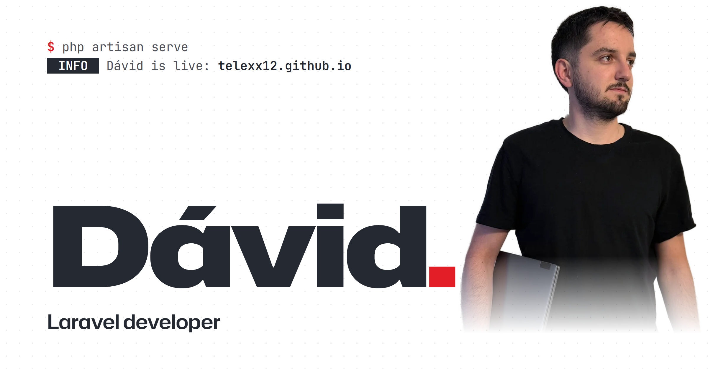

<p align="center">
  <a href="https://telexx12.github.io/"></a>
</p>

# david@earth: ~ first boot

```text
$ laravel new david-portfolio

 ██╗       █████╗  ██████╗   █████╗  ██╗   ██╗ ███████╗ ██╗
 ██║      ██╔══██╗ ██╔══██╗ ██╔══██╗ ██║   ██║ ██╔════╝ ██║
 ██║      ███████║ ██████╔╝ ███████║ ██║   ██║ █████╗   ██║
 ██║      ██╔══██║ ██╔══██╗ ██╔══██║ ╚██╗ ██╔╝ ██╔══╝   ██║
 ███████╗ ██║  ██║ ██║  ██║ ██║  ██║  ╚████╔╝  ███████╗ ███████╗
 ╚══════╝ ╚═╝  ╚═╝ ╚═╝  ╚═╝ ╚═╝  ╚═╝   ╚═══╝   ╚══════╝ ╚══════╝

  - Installing problem solving (9.0)
  - Installing curiosity (5.0)
  - Installing reliability (10.0)
  - Installing teamwork (7.0)
  - Installing creativity (8.0)
  - Installing independence (9.0)
  - Installing focus (6.0)
  - Installing eagerness to learn (10.0)
  - Installing communication (8.0)
  - Installing determination (9.0)
  - Installing systems thinking (7.0)
  - Installing precision (10.0)
  - Installing patience (8.0)
  - Installing responsibility (9.0)
  - Installing coffee tolerance (1.0)
 15/15 [▓▓▓▓▓▓▓▓▓▓▓▓▓▓▓▓▓▓▓▓] 100%

┌ Where should we install?
│ › Romania
└
┌ Release date?
│ 2001
└

 DONE  Dávid installed successfully.

$ php artisan serve
 INFO  Dávid is live: http://Earth:8000
```

**Live:** https://telexx12.github.io/ · English and Hungarian

This is my portfolio. It does not open with a hero image, it boots: `Journey` walks you through it station by station, `Jump` skips straight to the landing. Either way you land on the same page: `200 OK`.

## Education

- **High school** · 2015–2019 · Orbán Balázs Gimnázium
- **University** · 2019–2022 · Sapientia University
- **Self-development** · 2023– · Laracasts

## Work

| Route | Role | Years | What |
|---|---|---|---|
| `GET /leading-soft` | Junior PHP / Laravel Developer | 2022–2024 | CRMs, webshops, API integrations |
| `GET /freelance` | Freelance & own business | 2023– | REST APIs, webshop optimisation, A/B tests |
| `GET /scut-protection` | Mid-level PHP / Laravel Developer | 2024– | Business-critical systems, high-traffic webshops |

## Filters

```text
Middleware log
→ HandleExamSession .... ✓ got away with it
→ SurviveCovid ......... ✓ survived
→ AdoptToAIEra ......... ✓ still here
```

## Complex question, simple answer.

> I’m Dávid, a Laravel developer from Romania, working in the industry since 2022. I’ve worked on CRM, OMS and ERP systems and on webshops serving several European countries in multiple currencies. I’ve taken over and extended a legacy PHP codebase, designed REST APIs for mobile apps and internal systems, integrated payment providers, and optimised the performance of high-traffic backends.
>
> Yes, I use PHP, and yes, I can build fast systems with it. The two get along surprisingly well.

*"Controlling complexity is the essence of computer programming."* — Kernighan & Plauger

## What I’ve worked on.

| Project | Kind | Year | |
|---|---|---|---|
| **Scut Motor** | Webshop | 2024 | Romanian webshop for metal engine guards. |
| **Customer management** | CRM | 2022– | Customers, contacts and sales in one system. |
| **Order management** | OMS | 2022– | Orders from checkout to delivery. |
| **Resource planning** | ERP | 2022– | Stock, purchasing and finance in one system. |
| **Zynex** | Mobile app | 2026 | Personal finance app: see all your accounts in one place. |
| **UtilityMeter** | Web app | 2025 | Tracks utility meters and monthly readings by location. |
| **Szókirakó** | Mobile game | 2026 | A Hungarian offline word puzzle game for Android, level by level. |
| **GA4 & GTM** | Web analytics | 2023– | Web measurement and tag management with Google Analytics 4 and Tag Manager. |

## What I’ve written.

Short pieces about what I’ve learned while building and teaching. I’m working on the first posts.

## Digital presence

[GitHub](https://github.com/Telexx12) · [LinkedIn](https://www.linkedin.com/in/telegdi-d%C3%A1vid-4b29a428a) · [Stack Overflow](https://stackoverflow.com/users/telexx) · [Upwork](https://www.upwork.com/freelancers/~01f893ba367c73dfa3) · [Laracasts](https://laracasts.com/@Telexx) · [Monkeytype](https://monkeytype.com/profile/Telexx12)

## Get in touch.

Have a project, a question, or just want to say hi? Write a few lines and I’ll get back to you soon. The letter is at the bottom of [the site](https://telexx12.github.io/).

## Under the hood

- Plain HTML, CSS and JavaScript, GSAP for the animations. No framework, no build step.
- The page works with JavaScript off too (static fallback in `index.html`), and crawlers get `robots.txt`, `sitemap.xml`, `llms.txt` and JSON-LD.
- Fonts (Hubot Sans, JetBrains Mono) and GSAP are served from this repo; hosted on GitHub Pages.
- `index.html` is the shell, `components/` holds the sections, `assets/` the CSS, JS, fonts, images and the two dictionaries, `docs/` the specs for blog posts and the static layer.

Run it locally with any static server, for example:

```text
$ python -m http.server 8000
 INFO  Dávid is live: http://localhost:8000
```
